# Hermes-Automation 架构现状盘点（ARCHITECTURE.md）

> 生成日期：2026-10-31 ｜ 性质：只读架构评估，不改任何代码/配置
> 核心问题：**目前架构怎么样？缺什么？**
> 证据来源：`services/daemon_scheduler.py` 源码逐行核实、daemon 实际运行接口（GET /status、/logs，禁止 /trigger）、4 个 SKILL.md 与文件系统交叉核对、`docs/AUDIT-tools-cleanup.md`。

---

## 1. 一句话总览

这是一个**单机、单进程、文件驱动**的个人 AI 自动化体系：一个自研 Python 调度 daemon（`services/daemon_scheduler.py`，HTTP :28987）以子进程方式周期拉起 `tools/` 与 `services/` 下的脚本，产物落 `data/` 与 `reports/` 目录，经 Telegram Bot 播报；AI Agent（ZCode/Hermes）通过 `.agents/skills/` 下 4 个 skill 读取文档与调用 HTTP 接口介入人工环节。**"能跑、自成闭环"，但工程基础设施（版本控制、依赖锁定、测试、日志轮转、密钥管理）基本为零，secret 大面积硬编码在源码中。**

---

## 2. 组件清单

| 组件 | 路径 | 角色 | 现状证据 |
|---|---|---|---|
| 调度 daemon | `services/daemon_scheduler.py` (453 行) | 中央调度 + REST API + 单实例锁（端口排他） | 运行中，uptime ~5.4h（GET /status 实测） |
| 静默启动器 | `services/run_daemon_silent.vbs` | pythonw 无窗口拉起 daemon | `WshShell.Run "...pythonw.exe" "...daemon_scheduler.py", 0, False` |
| 任务脚本池 | `tools/`（259 个 .py + 5 个 .ps1） | 各任务实现 + 大量一次性实验脚本 | 仅 ~13 个被调度/skill 引用，223 个可清理（见 `docs/AUDIT-tools-cleanup.md`） |
| 公共推送库 | `services/wool_radar.py` | Telegram 发送 + 被 10+ 脚本 import（事实上的 lib，却放在 services/ 且自身也是任务） | `from wool_radar import send_telegram_text, TOPIC_*_ID` |
| 接码器 | `services/mail_receiver.py` | IMAP 验证码提取（chatanywhere_harvester 依赖） | daemon_scheduler.py 未直接引用 |
| 状态/配置层 | `config/` | `scheduler_state.json`、`keys_pool.json`(5 节点)、`monitored_articles.json`、`alerted_comments.json`、`credentials.json`(959B, 不读取内容)、`hermes_channel.json` | 均为裸 JSON 文件读写 |
| 数据产物层 | `data/` | 8 个 vault 子目录 + 3 个 SQLite db（github_gems/niche_gems/practical_tools/cs408_exam_vault）+ 6 个 notes_*.jsonl | 见 §3 数据流 |
| 报告产物层 | `reports/` | hermes_output、github_gems、stockpile_drafts、xiaoheihe_articles、scheduler.log 等 + 130+ 张截图散落 | scheduler.log 85KB 无轮转 |
| Skill 体系 | `.agents/skills/`（4 个） | host-automation / post-xiaoheihe / xhh-style-bible / windows-batch-powershell | 详见 §5 |
| 独立子项目 | `cs408-dashboard/` | server.py(:8088) + index.html/js/css + start.bat，408 知识图谱可视化 | 与主体系仅靠 `reports/master_408_graph_data.json` 松耦合 |
| 入口文档 | `README.md` | 架构说明 | **部分过期**：引用 `skills/` 路径（实际为 `.agents/skills/`）；L24 明文粘贴了一个已入库的真实 API Key；未提及 daemon_scheduler.py（系统真正的核心） |

根目录另有约 40 个散落实验产物（13 个 .py、14 个 .png、2 个 .zip、临时 html/jpg），属 waifu 封面实验残留，未清理。

---

## 3. 架构与数据流图

```mermaid
flowchart TB
    subgraph HOST["Windows 宿主机 C:\Users\zzx05\Hermes-Automation"]
        VBS["run_daemon_silent.vbs<br/>(pythonw 静默)"] --> DAEMON

        subgraph DAEMON["daemon_scheduler.py :28987 (单实例=端口排他)"]
            LOOP["main_loop: 60s 轮询<br/>state 时间戳 + interval 判断"]
            API["HTTP API<br/>GET /status /keys /tasks /logs<br/>GET+POST /trigger<br/>/data 文件读取"]
            STATE[("config/scheduler_state.json")]
        end

        LOOP -->|"subprocess.run<br/>timeout=600s"| TASKS
        LOOP <--> STATE

        subgraph TASKS["9 个定时任务 (tools/ + services/)"]
            T1[weekly_github_digest]
            T2[cn_intel_search<br/>--freegames / --bili]
            T3[wool_radar --once]
            T4[batch_welfare_harvester<br/>→ chatanywhere/docode_harvester<br/>→ mail_receiver IMAP]
            T5[daily_wool_checkin]
            T6[postgrad_exam_papers_harvester]
            T7[fetch_official_full_pdf_papers]
            T8[xhh_comment_sentinel]
        end

        T4 --> KEYS[("config/keys_pool.json<br/>活态 Key 池")]
        T5 --> KEYS
        T8 --> ALERT[("config/alerted_comments.json<br/>config/monitored_articles.json")]

        T1 & T2 & T3 & T4 & T6 & T8 --> TG["Telegram Bot<br/>(wool_radar.send_telegram_*)<br/>话题3 羊毛/话题4 GitHub/话题5 交互"]
        T3 --> HIST[("services/pushed_history.json<br/>去重")]

        subgraph OUT["产物层"]
            DATA[("data/<br/>8 个 vault + SQLite×4 + notes_*.jsonl")]
            REPORTS[("reports/<br/>hermes_output / github_gems /<br/>stockpile_drafts / xiaoheihe_articles /<br/>CS_*.md / scheduler.log")]
            DESKTOP["C:\Users\zzx05\Desktop\考研408<br/>(试卷 PDF 直落桌面)"]
        end
        T1 & T2 & T6 --> REPORTS
        T7 --> DESKTOP

        LOG[("reports/scheduler.log<br/>append-only 无轮转")]
        DAEMON --> LOG
    end

    subgraph AGENT["AI Agent 层 (ZCode / Hermes)"]
        S1["skill: host-automation<br/>HTTP 遥控 daemon"]
        S2["skill: post-xiaoheihe<br/>自带 scripts/ CDP 发帖"]
        S3["skill: xhh-style-bible<br/>纯文档风格库"]
        S4["skill: windows-batch-powershell<br/>纯文档规范"]
    end
    S1 -->|"HTTP 127.0.0.1:28987<br/>(SKILL.md 写 host.docker.internal)"| API
    S2 -->|"读取 reports/xiaoheihe_articles 素材"| REPORTS

    subgraph SIDE["独立子项目"]
        CS408["cs408-dashboard<br/>server.py :8088 + 静态页"]
        GRAPH[("reports/master_408_graph_data.json")]
    end
    GRAPH --> CS408

    subgraph LLM["LLM 依赖 (运行时动态挂载)"]
        ZG["ZeroGate-ZCode 中转<br/>http://100.114.18.45:7863/v1<br/>(hermes_channel.json + 多脚本硬编码 fallback)"]
    end
    T1 & T2 & T6 -.->|"keys_pool 挑活态节点"| LLM
```

数据流要点（源码核实）：

- **调度闭环**：`main_loop()`（daemon_scheduler.py:414-448）每 60s 读 `scheduler_state.json` 时间戳，到期即 `subprocess.run` 同步执行（timeout 600s，超 600s 的任务会被硬杀），触发瞬间与结束时各写一次时间戳。
- **Key 池是枢纽**：`welfare_harvester`（收割+测活写入）→ `daily_checkin`（测活+余额同步写入）→ 各 LLM 任务（`get_best_llm_node()` 读活态节点）形成生产/消费环。
- **Telegram 是唯一告警出口**：所有任务通过 import `wool_radar` 的发送函数推送；`xhh_comment_sentinel` 走 `tools/tg_notify.py`（含一个已失效的 `docker exec hermes` fallback，宿主机上 docker 不存在时静默降级）。
- **产物去向**：`data/`（vault/db/jsonl 长期资产）、`reports/`（报告与截图，混杂）、`Desktop/考研408`（唯一越出项目根的落盘点，fetch_official_full_pdf_papers.py:26）。

---

## 4. daemon 任务全表（源码逐个核实）

来源：`services/daemon_scheduler.py` L56-112 `TASKS` 字典；全部 9 个脚本已确认存在于磁盘；运行状态来自 GET /status 实测（2026-10-31 01:35）。

| 任务 key | 名称 | interval | 依赖脚本（绝对核实） | 产出物 / 副作用 | 最近运行 |
|---|---|---|---|---|---|
| `weekly_github` | GitHub 高星脱水周报 | 7 天 (168h) | `tools/weekly_github_digest.py` | GitHub API 搜索→LLM 脱水→TG 话题 4 推送（内存生成，无落盘） | 10-27 19:25 正常 |
| `freegames` | 游戏限免喜加一巡检 | 3 天 (72h) | `tools/cn_intel_search.py` +args `--freegames` | Epic 等限免抓取→TG 话题 3 推送（无落盘） | 10-30 20:13 正常 |
| `bili_intel` | B站硬核技术与API速递 | 3 天 (72h) | `tools/cn_intel_search.py` +args `--bili 免费API` | B 站搜索→LLM 脱水→TG 推送（无落盘） | 10-30 20:13 正常 |
| `wool_radar` | 全网基建羊毛雷达扫描 | 6 小时 | `services/wool_radar.py` +args `--once` | 多源情报→TG 话题 3；去重写 `services/pushed_history.json` | 10-30 20:13 正常 |
| `welfare_harvester` | 公益中转站活态Key收割与测活 | 12 小时 | `tools/batch_welfare_harvester.py`（传递依赖 `chatanywhere_harvester.py`、`docode_harvester.py`、`mail_receiver.py`） | 写 `config/keys_pool.json`；TG 话题 3 播报 | 10-30 20:14 正常 |
| `daily_checkin` | 每日中转站自动签到与额度巡检 | 24 小时 | `tools/daily_wool_checkin.py` | 全池测活更新 `config/keys_pool.json`；写 `reports/daily_checkin.log` | 10-30 20:16 正常 |
| `postgrad_papers` | 408+数二+英二真题与精解提纯 | 3 天 (72h) | `tools/postgrad_exam_papers_harvester.py` | LLM 生成→写 `reports/CS_Postgrad_408_Math2_English2_Papers.md`；TG 推送 | 10-30 20:21 正常 |
| `build_print_papers` | 桌面打印店专用全套试卷 | 7 天 (168h) | `tools/fetch_official_full_pdf_papers.py` | PDF 下载落 `C:\Users\zzx05\Desktop\考研408`（越出项目根） | 10-30 20:21 正常 |
| `xhh_comments_sentinel` | 小黑盒恶评与带节奏巡检 | **10 分钟 (600s)** | `tools/xhh_comment_sentinel.py`（依赖 `tools/tg_notify.py`） | 写 `config/alerted_comments.json`；读 `config/monitored_articles.json`；TG 预警 | 01:34:49 正常（近 30 条日志全绿） |

补充事实：
- `xhs_probe` 已停用（daemon L111 注释归档），但 `scheduler_state.json` 中仍残留其时间戳。
- `/trigger?task=xxx` 校验 `task_key in TASKS`（daemon_scheduler.py:285-286），**只接受上表 9 个 key**。
- API 完整路由（源码 L241-399）：GET `/status`（`/`、`/health` 等价）、`/keys`、`/tasks`、`/trigger?task=&sync=`、`/logs?n=`、`/xhs_status`、`/xhs_notes`（别名 `/notes`、`/xhs_dump`）、`/data[/*]`（带防路径遍历检查）；POST `/trigger/<task>`。
- **HTTP 服务实际监听 `0.0.0.0:28987`**（L407），docstring 里写的"127.0.0.1"与代码不符——局域网内任意设备可读 Key 池、触发任务。
- 所有任务共享 600s 硬超时与串行 `time.sleep(5)`；任务崩溃仅写日志 + stderr 前 300 字，无重试、无告警升级。

---

## 5. Skill 体系现状

| Skill | 覆盖内容 | 脚本/接口核实结果 |
|---|---|---|
| **host-automation** (v1.1.0) | 遥控宿主 daemon：查状态/Key 池/日志、按需触发 7 个任务、读 data 目录 | **发现 3 处承诺与实现不符**，见下方详表 |
| **post-xiaoheihe** | 小黑盒图文创作+发布全流水线（CDP 控制 Chrome，存草稿） | 自带 `scripts/` 8 个文件（xhh_build/xhh_check/xhh_fill_text/xhh_verify_draft/xhh_common/start_chrome.py+.bat/check.bat）**全部存在**；`assets/cube_emojis.json`、`references/editor_internals.md` 存在。SKILL.md 要求 `.venv\Scripts\python.exe`，但 **`.venv/` 目录不存在**（仅在别的机器装过或被清理），首次使用会直接失败 |
| **xhh-style-bible** | 167 篇热帖提炼的写作风格库，渐进式披露（SKILL.md + references/track_*.md ×5 + corpus/） | 纯文档，引用的分册文件**全部存在**，无脚本依赖，无失配 |
| **windows-batch-powershell** | .bat/.ps1 编码与 UAC 规范（GBK/UTF-8 黄金法则） | 纯规范文档，无脚本承诺，无失配 |

### host-automation SKILL.md ↔ daemon 实际路由逐条核对

| SKILL.md 承诺 | daemon 实际 | 结论 |
|---|---|---|
| `GET /status` | 存在（另有 `/health` 等价） | 一致 |
| `GET /keys` | 存在，返回 keys_pool.json 全量（**含明文 api_key**） | 一致（有泄露面） |
| `GET /logs?n=30` | 存在 | 一致 |
| `GET /data` | 存在（还多了 /data/<path> 文件读取） | 一致 |
| `/trigger?task=` ×7：wool_radar、welfare_harvester、freegames、bili_intel、weekly_github、postgrad_papers、build_print_papers | 7 个 key **全部在 TASKS 注册**，可触发 | 一致 |
| "Xiaoheihe Niche Gems Scout"：`python tools/niche_gem_harvester.py`、`python tools/vision_auditor.py` | 两个脚本存在，但**不是 daemon 任务**，也无对应 `/trigger` key（daemon 只有 `xhh_comments_sentinel` 涉及小黑盒，但那是评论巡检不是挖宝） | **部分失配**：skill 让 Agent 以为这是可遥控任务，实际是宿主机手工跑的独立脚本 |
| base_url `http://host.docker.internal:28987` | daemon 监听 0.0.0.0，从宿主机本地访问应用 127.0.0.1；`host.docker.internal` 仅在 Docker 容器内可解析（README 描述的 Hermes Docker 容器是历史架构，`docker exec hermes` fallback 在当前宿主已无 docker） | **环境漂移**：文档指向旧 Docker 架构，新 Agent 在宿主机上照抄会连接失败 |
| `related_skills: [infra-giveaway-triage]` | 项目内不存在该 skill | **悬空引用** |
| （未提及）| daemon 实际还有 `/tasks`、`/xhs_status`、`/xhs_notes`、POST `/trigger/<task>`、`sync=1` 同步模式 | skill 覆盖不全（信息缺失，非错误） |

另核实 SKILL.md 所在声明 `platforms: [linux, macos, windows]`，但其所有脚本与路径均 Windows 专属——元数据与实际不符。

---

## 6. 基础设施评估

| 维度 | 现状 | 运维风险 |
|---|---|---|
| **版本控制** | **无 git**（`.git` 不存在；有 `.gitignore` 说明曾计划用） | 一次误删/磁盘故障即全灭，223 个历史脚本无任何回滚点；无法追溯"哪个版本在跑" |
| **依赖清单** | **无 requirements.txt / pyproject.toml**（根目录无；仅 post-xiaoheihe skill 内自带一份，且其 .venv 缺失） | 已知隐式依赖：requests、playwright、ddddocr、Pillow 等，全装在全局 Python 3.11；重装机器或 pip 升级破坏兼容时无从复原 |
| **测试** | **无任何自动化测试**。根目录 4 个 test_*.py 和 tools/ 下 10+ 个 test_*.py 全是当时的手工实验脚本，非回归测试 | 调度逻辑、防重复、路径遍历防护等全靠人肉验证；改 wool_radar（被 10+ 脚本 import）无安全网 |
| **日志** | daemon 写 `reports/scheduler.log`（append-only，85KB，无轮转无级别）；daily_checkin 自带独立 log；HTTP 访问日志被屏蔽 | 长期运行无限增长；多进程并发 append 无锁；出错只留 stderr 前 300 字，排查困难 |
| **vbs 静默守护** | `run_daemon_silent.vbs` 用 pythonw 拉起，窗口隐藏（参数 0） | **无开机自启**（未发现注册为计划任务/启动项的证据，重启后需手工双击）；**无进程守护**（pythonw 崩了就永久下线，无告警——恰好 daemon 自身是唯一知道"自己死了"的组件，死后无人发 TG）；stdout 为 DummyStream，print 全部丢弃 |
| **单实例锁** | 以"端口绑定成功"为排他锁（L407-422） | daemon 假死占端口时，新实例静默 `sys.exit(0)`，用户以为启动了其实没有 |
| **配置管理** | 裸 JSON 文件，无 schema 无校验；`hermes_channel.json` 实际以 GBK 混杂内容写出（本工具读取出现乱码） | 一个手滑改坏 keys_pool.json 即可让 3 类任务连锁失败 |
| **入口文档** | README.md 过期（skills 路径、无 daemon 说明）+ **L24 明文粘贴真实 API Key** | 新会话/新协作者被误导；密钥已进文档 |

---

## 7. 架构缺口与风险清单（P0-P3）

> P0=正在发生/随时引爆；P1=高概率事故；P2=明显债务；P3=改善项。

| 级别 | 缺口/风险 | 证据（文件路径） |
|---|---|---|
| **P0** | **明文密钥大面积硬编码在源码**：Telegram bot token+chat_id 写死在 wool_radar.py、tg_notify.py、weekly_github_digest.py 等至少 4 处；ZeroGate 中转 key `sk-zg-****(已打码)` 作为 fallback 硬编码在 weekly_github_digest.py:40、cn_intel_search.py:37；`/keys` 接口与 keys_pool.json 本身存明文 api_key；README.md:24 直接印出一个真实 Key。`.gitignore` 虽排除了 credentials.json，但真正的泄露面在**代码与文档内** | `services/wool_radar.py:17-19`、`tools/tg_notify.py:5-6`、`tools/weekly_github_digest.py:9-10,40`、`tools/cn_intel_search.py:37`、`config/keys_pool.json`、`README.md:24` |
| **P0** | **无版本控制 + 密钥在文件里**：无 git 意味着无法安全地"先提交再重构"；`docs/AUDIT-tools-cleanup.md` 已判定 223 个脚本可删，但没有 git 的删除是一次性破坏性操作 | 项目根（`.git` 缺失）、`docs/AUDIT-tools-cleanup.md` |
| **P0** | **REST API 绑定 0.0.0.0 无鉴权**：局域网内任意主机可 GET `/keys`（拿全部明文 Key）、`/data/<file>`（读 data 下任意文件）、POST `/trigger`（随时拉起浏览器自动化任务）；`Access-Control-Allow-Origin: *` 又放大了浏览器侧 CSRF 面 | `services/daemon_scheduler.py:407`（0.0.0.0）、`:237`（CORS *）、`:267-277`（/keys 返回明文 key） |
| **P1** | **无进程守护、无开机自启、无死透告警**：vbs 手工启动，pythonw 崩溃即静默下线且无人知晓；daemon 是唯一告警通道，它死后 TG 不会再发任何消息 | `services/run_daemon_silent.vbs`；`daemon_scheduler.py:33-38`（stdout 丢弃） |
| **P1** | **单点公共库 `wool_radar.py`**：既是定时任务又是 10+ 脚本的 Telegram 推送库，改一处即全量任务受影响，且无测试兜底 | `services/wool_radar.py`；`docs/AUDIT-tools-cleanup.md` §一（传递依赖表） |
| **P1** | **依赖不可重建**：全局 Python 3.11 + requests/playwright/ddddocr 无版本锁定；cs408-dashboard、post-xiaoheihe 各自需要额外依赖也无根级清单 | 根目录无 requirements.txt/pyproject.toml；`.agents/skills/post-xiaoheihe/requirements.txt` 孤立 |
| **P2** | **600s 硬超时可能误杀慢任务**：welfare_harvester（注册+IMAP 等码+测活）、build_print_papers（批量下载 PDF）接近或超过 10 分钟即被 kill，且无重试，下次要等 12h/7d | `services/daemon_scheduler.py:170-177` |
| **P2** | **tools/ 259 个脚本仅 ~13 个在用**（223 个可清理），且根目录另有 40 个实验残留（13 py + 14 png + zip/html/jpg），检索与安全审计成本持续放大 | `tools/`、项目根、`docs/AUDIT-tools-cleanup.md` |
| **P2** | **日志无轮转、无结构化**：scheduler.log 永续 append；任务失败仅记 stderr 300 字 + 返回码，缺任务耗时、重试、统计维度 | `services/daemon_scheduler.py:118-131,183`、`reports/scheduler.log` (85KB) |
| **P2** | **README.md 过期且含真实 Key**：skills 路径写成 `skills/`（实际 `.agents/skills/`）；完全未提 daemon_scheduler.py、cs408-dashboard、data/ 体系 | `README.md:32`（路径）、`README.md` 全文（无 daemon 章节）、`README.md:24`（Key） |
| **P2** | **调度状态与业务状态混放 config/**：scheduler_state.json、alerted_comments.json 是运行时状态，keys_pool.json、monitored_articles.json 是业务数据，hermes_channel.json 已乱码——无备份机制，一个文件写坏连锁多任务 | `config/` 全目录；`config/hermes_channel.json`（编码异常） |
| **P3** | **host-automation SKILL.md 三处漂移**：host.docker.internal 指向已退役的 Docker 架构、niche_gem_harvester/vision_auditor 非 daemon 任务却混入 trigger 清单、related_skills 指向不存在的 infra-giveaway-triage | `.agents/skills/host-automation/SKILL.md:17,64-70,12` |
| **P3** | **post-xiaoheihe .venv 缺失**：SKILL.md 强制 `.venv\Scripts\python.exe` 但目录不存在，换机/清理后流水线直接断 | `.agents/skills/post-xiaoheihe/SKILL.md:44` vs 目录清单 |
| **P3** | **落盘越界**：build_print_papers 直写 `C:\Users\zzx05\Desktop\考研408`，脱离 data/、reports/ 管理范围，备份与清理策略覆盖不到 | `tools/fetch_official_full_pdf_papers.py:26` |
| **P3** | **失效的 docker fallback**：xhh_comment_sentinel 在 tg_notify 失败时尝试 `docker exec hermes`，当前宿主无 docker 容器，属死代码且掩盖真实发送失败 | `tools/xhh_comment_sentinel.py:61-65` |
| **P3** | **无测试**：调度防重、路径遍历防护（daemon_scheduler.py:361）、keys_pool 读写竞态等关键逻辑零回归覆盖 | 全项目无 test 框架 |

---

## 8. 结论：架构健康度

**一句话判断：业务闭环成立、任务全部健康运行（9/9 近期执行正常）的"能用"级个人自动化系统，但工程底座缺失严重——无 git、无依赖锁定、无测试、无守护，且明文密钥散布在源码、文档与 HTTP 接口三处，属于"功能健康、工程与安全亚健康"，任何一次重装、误删或局域网暴露都可能造成不可逆损失。**

优先行动建议（对应上文缺口，供后续决策）：① 打破 P0 —— 立即 git init + 把密钥迁入 .env/环境变量并轮换已暴露的 token/key（含 README:24 那个）；② API 收敛到 127.0.0.1；③ 再执行 docs/AUDIT-tools-cleanup.md 的清理（有 git 后才安全）。
